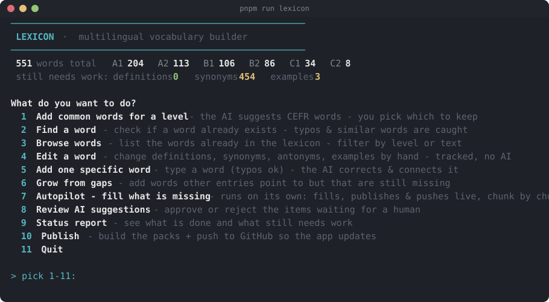

# Lexicon Platform

[](https://github.com/massimomazzariol/Lexicon/actions/workflows/ci.yml)
[](https://massimomazzariol.github.io/Lexicon/)
[](LICENSE)
[](docs/CONTENT_LICENSE.md)

Open, curated vocabulary for language learning: German, English and Italian,
CEFR-leveled from A1 to C2, with definitions, word forms, examples, idiomatic
expressions and links between related words.

**[Browse the content live](https://massimomazzariol.github.io/Lexicon/)**. The
explorer reads the same files consumers download.

## Why

Good open vocabulary data is hard to find: sources disagree, levels are
incoherent, and links between words are missing. Generating entries on demand
costs money on every call and gives a different answer each time.

Lexicon writes each entry once, reviews it, and ships it as static,
versioned JSON files:

- **Same answer every time.** Every change is a reviewed git diff.
- **Leveled and linked.** CEFR levels and word links are decided once.
- **Cheap to serve.** Consumers download the files and use them offline.

## Use the content

Download the distribution from the
[latest release](https://github.com/massimomazzariol/Lexicon/releases/latest):
`root_manifest.json`, one index per language, and a `manifest.json` plus
`content.json` per pack. Every file carries `contract_version`, so a consumer
can reject a version it does not understand.

That distribution is the only contract. Read `CONTRACT.md` and
`docs/guides/CONSUMER_GUIDE.md`.

## Work on the content

Requirements: Node 22 or later and pnpm.

```bash
pnpm test           # run the tooling tests
pnpm run lexicon    # open the authoring console
pnpm run release    # rebuild the packs and dist/lexicon_distribution/
```



New entries start as `needs_review`. Only reviewed entries reach a pack, and
the git diff is the final check. Grammar such as German noun forms or
separable verbs (`auf|stehen`) lives in language plugins, so adding a
language does not change the core.

Publishing a release is a maintainer task: see `docs/guides/RELEASING.md`.

## Docs

- `CONTRACT.md`: the distribution contract
- `docs/README.md`: documentation map
- `docs/guides/CONSUMER_GUIDE.md`: using the distribution
- `docs/guides/PACK_AUTHORING.md`: writing entries
- `docs/reference/WORKFLOW_COMMANDS.md`: all commands
- `CONTRIBUTING.md`: how to contribute

## License

Code (`tools/`) is Apache-2.0. Content, packs and docs are CC BY 4.0 unless
noted otherwise. See `LICENSE`, `docs/CONTENT_LICENSE.md`, `NOTICE` and
`ATTRIBUTION.md`.
